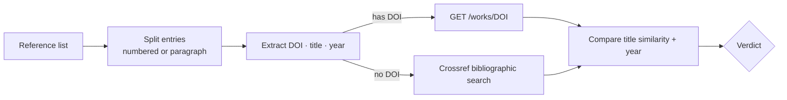

<h1 align="center">📚 Citation Hallucination Checker</h1>

<p align="center">
  <b>Catch fabricated references before your reviewers do.</b><br/>
  Checks every citation in a reference list against the Crossref registry: DOI, title and year.
</p>

<p align="center">
  
  
  
  
  <a href="https://github.com/amanatarslan270-cyber/citation-hallucination-checker/actions"></a>
</p>

---

## Why

LLMs often produce **citations that look real but don't exist**: plausible authors, a convincing title, a DOI that resolves to nothing, or a real paper with the wrong year. These end up in student theses, AI-assisted manuscripts and RAG answers.

`citecheck` takes a reference list (from a paper, a ChatGPT answer or a `.bib` export rendered as text) and labels each entry:

| Status | Meaning |
|---|---|
| ✅ `verified` | A registered record matches the title (≥ 0.90 similarity) and year |
| ⚠️ `suspicious` | A record exists, but the title or year doesn't match. Often a "mutated" real paper |
| ❌ `not_found` | The DOI is not registered, or no record has a similar title |
| ❔ `unparseable` | Neither a DOI nor a title could be found |

## How it works



## Quick start

```bash
git clone https://github.com/amanatarslan270-cyber/citation-hallucination-checker.git
cd citation-hallucination-checker
pip install -e .

export CROSSREF_MAILTO=you@example.com   # optional: Crossref "polite pool", faster and more reliable
citecheck references.txt --json results.json
```

`references.txt`:

```
[1] A. Vaswani et al., "Attention Is All You Need", NeurIPS, 2017.
[2] J. Devlin et al., "BERT: Pre-training of Deep Bidirectional Transformers for Language Understanding", NAACL, 2019.
[3] R. Khan, "Quantum Transformers for Low-Resource Urdu Poetry Generation", 2023. doi:10.9999/fake.42
```

Output format (one line per reference):

```
✅ [1] VERIFIED: matched via search
⚠️ [n] SUSPICIOUS: year <cited> vs registered <actual>
     closest record: <registered title> (doi:<doi>)
❌ [3] NOT_FOUND: DOI 10.9999/fake.42 is not registered

Summary: verified=…, suspicious=…, not_found=…, unparseable=…
```

### Python API

```python
from citecheck import CitationChecker

for v in CitationChecker().check_text(open("refs.txt").read()):
    print(v.status, v.similarity, v.matched_doi)
```

The HTTP layer can be injected (`CitationChecker(fetch=my_fetch)`), so you can add caching, use another registry (OpenAlex, Semantic Scholar) or mock it in tests.

## Use cases

- Screening **LLM-generated literature reviews** and RAG answers
- Checking **student theses** and manuscripts before submission
- Building **labelled datasets** for citation-hallucination research

## Limitations

- Crossref covers most journals and conferences, but not every arXiv-only preprint or book chapter. An item marked `not_found` is a *flag for manual review*, not proof of fabrication.
- Title extraction is heuristic (quoted titles and APA style work best).

## Roadmap

- [ ] OpenAlex and Semantic Scholar fallbacks for preprints
- [ ] Author-list verification
- [ ] BibTeX input and Urdu-script reference parsing
- [ ] Web demo on Hugging Face Spaces

## Author

**Muhammad Arslan**, Agentic AI Engineer and NLP Researcher, University of Sahiwal
[LinkedIn](https://www.linkedin.com/in/arslan-amanat-393186380) · [GitHub](https://github.com/amanatarslan270-cyber)

## License

MIT
